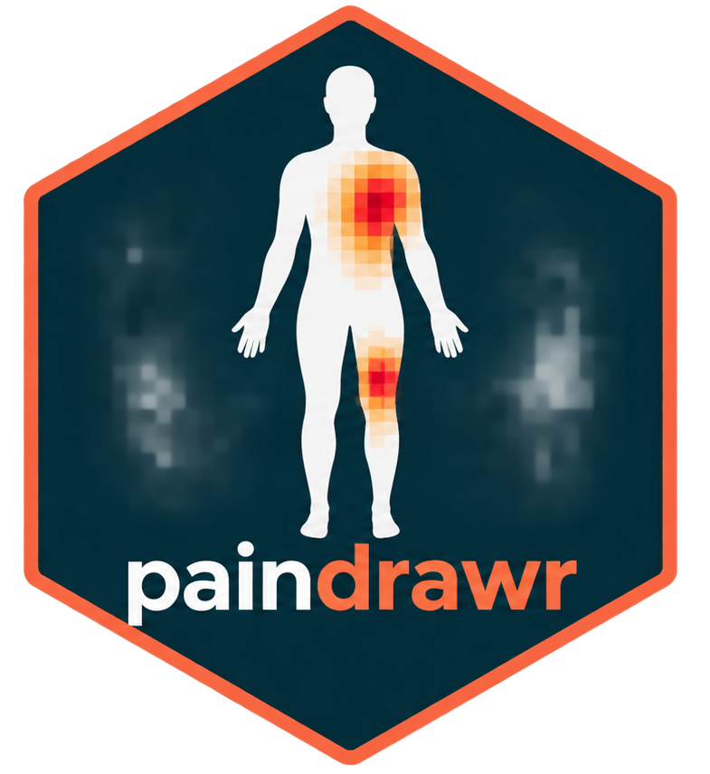
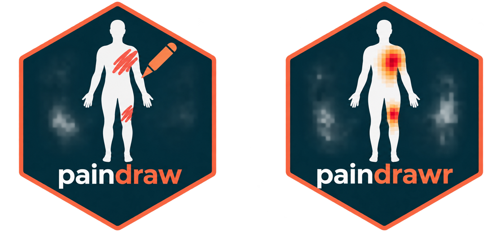

<!-- README.md is generated from README.Rmd. Please edit that file -->

```{r, include = FALSE}
knitr::opts_chunk$set(
  collapse = TRUE,
  comment = "#>",
  fig.path = "man/figures/README-",
  out.width = "100%"
)
```

# paindrawr 

<!-- badges: start -->
[](https://github.com/steenharsted/paindrawr/actions/workflows/R-CMD-check.yaml)
[](https://app.codecov.io/gh/steenharsted/paindrawr)
<!-- badges: end -->

**paindrawr** helps you import, transform, quantify, and visualise *pain
drawings* — schematic illustrations on which patients mark where they feel
pain on an outline of the human body.

Pain drawings have traditionally been scored by dividing the body into a
fixed set of anatomical regions and recording, for each region, whether it
was marked or not. Modern digital tools (web and tablet apps) instead capture
each drawing as a series of pen-stroke *x/y coordinates*. This coordinate-based
data is far richer, but it is also harder to work with. paindrawr provides a
consistent workflow for turning that raw coordinate data into figures and
quantitative summaries.

## Installation

You can install the development version of paindrawr from
[GitHub](https://github.com/steenharsted/paindrawr) with:

```r
pak::pak("steenharsted/paindrawr")
```

## Collect with paindraw. Analyse with paindrawr.



**paindraw** is a REDCap external module for collecting digital pain drawings.

**paindrawr** is an R package for importing, quantifying, analysing,
and visualising pain drawings.

Together, they provide a workflow from digital data collection
to research-ready results.


## Typical workflow

paindrawr functions are organised around a common analysis pipeline:

1. **Import** raw drawings: `pdr_import_json()`, `pdr_import_png()`
2. **Check** that the data is well-formed: `pdr_match()`
3. **Rasterise** the strokes to an RGBA array with `pdr_add_rgba()`. Choose
   `polygon = "none"` to keep strokes as drawn, or `"pen"`, `"spray"` or
   `"both"` to render them as filled polygons.
4. **Quantify** the marked areas: `pdr_summarize_rgba()`
5. **Visualise** the results: `pdr_plot_xy()`, `pdr_plot_rgba()`,
   `pdr_plot_rgba_heatmap()`

## Data structure

paindrawr works with a tibble in which each row is one respondent. The pain
drawings live in a dedicated list-column (named `pdr_data` by default, but any
name can be used), so that each drawing, with its metadata, strokes and point
coordinates, travels alongside covariates such as sex, age, symptom duration or
pain intensity.

The package ships with `pdr_example_data`, which has exactly this format and is
used throughout the documentation. See `?pdr_match` for the terminology
(pdr_drawing, pdr_list, pdr_tibble).

## Example

The `pdr_*()` functions are designed to be used with the native pipe (`|>`)
alongside tidyverse verbs such as `mutate()` and `filter()`.

```{r example}
#| message: false
#| warning: false
library(paindrawr)
library(tidyverse)

pdr_example_data
```

The example data contains `r nrow(pdr_example_data)` respondents. Metadata
stored inside each drawing can be extracted with `pdr_get_info()`, for example
the canvas width:

```{r get-info}
pdr_example_data |>
  mutate(width = pdr_get_info(pdr_data, id1 = ".width"))
```

### Plot a single drawing

`pdr_plot_xy()` redraws a drawing from its coordinates. Plots are easier to
interpret with the background image that was used during data collection;
read your own PNG with `png::readPNG()`.

```{r plot-drawing}
background <- png::readPNG(pdr_example_file("bg_full_body.png"))

pdr_example_data |>
  head(1) |>
  pdr_plot_xy(background_image = background)
```

Strokes can also be rendered as filled polygons, which is typically sensible
for pen tools (whereas spray tools produce many individual points):

```{r plot-polygon}
pdr_example_data |>
  head(1) |>
  pdr_plot_xy(background_image = background, polygon = "both")
```

### Quantify drawings

Quantification and heatmaps work on a rasterised representation of each
drawing, added to the list-column with `pdr_add_rgba()`:

```{r add-rgba}
pd <- pdr_example_data |>
  mutate(pdr_data = pdr_add_rgba(pdr_data, polygon = "both"))
```

`pdr_summarize_rgba()` then computes summary statistics, such as the number of
drawn pixels (`px`) and the proportion of the canvas covered (`area_prop`):

```{r summarize}
pd |>
  pdr_summarize_rgba(summary_stat = c("px", "area_prop")) |>
  select(-pdr_data)
```

Supplying `stencils` (for example body regions) gives statistics per region;
see `?pdr_summarize_rgba`.

### Heatmaps across groups

`pdr_plot_rgba_heatmap()` aggregates many drawings into density heatmaps,
optionally stratified by one or two grouping variables. Here we stratify by
symptom duration:

```{r plot-heatmap}
#| message: false
pd |>
  pdr_plot_rgba_heatmap(
    variables = "duration",
    background_image = background
  )
```

## Importing your own data

```r
# Drawings exported as JSON from the REDCap PainDraw module
pdr_import_json(list.files("path/to/json", full.names = TRUE))
```

See `?pdr_import_json` and `?pdr_import_png` for details.
