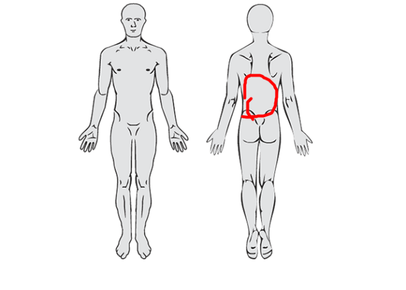
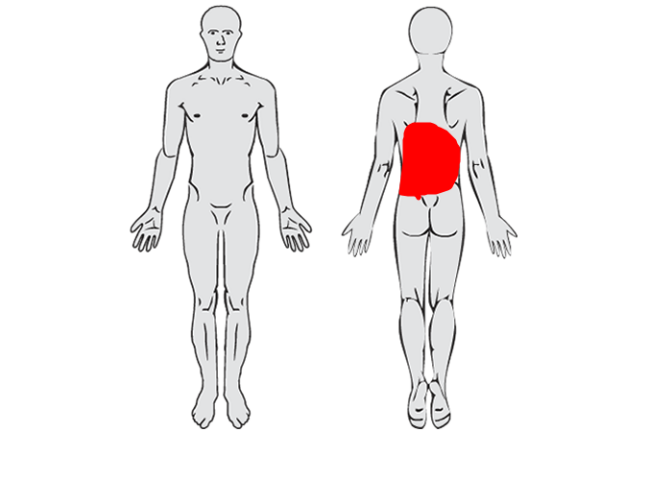

<!-- README.md is generated from README.Rmd. Please edit that file -->

# paindrawr 

<!-- badges: start -->

[](https://github.com/steenharsted/paindrawr/actions/workflows/R-CMD-check.yaml)
[](https://app.codecov.io/gh/steenharsted/paindrawr)
<!-- badges: end -->

**paindrawr** helps you import, transform, quantify, and visualise *pain
drawings* — schematic illustrations on which patients mark where they
feel pain on an outline of the human body.

Pain drawings have traditionally been scored by dividing the body into a
fixed set of anatomical regions and recording, for each region, whether
it was marked or not. Modern digital tools (web and tablet apps) instead
capture each drawing as a series of pen-stroke *x/y coordinates*. This
coordinate-based data is far richer, but it is also harder to work with.
paindrawr provides a consistent workflow for turning that raw coordinate
data into figures and quantitative summaries.

## Installation

You can install the development version of paindrawr from
[GitHub](https://github.com/steenharsted/paindrawr) with:

``` r
pak::pak("steenharsted/paindrawr")
```

## Collect with paindraw. Analyse with paindrawr.

<p align="center">


</p>

**paindraw** is a REDCap external module for collecting digital pain
drawings.

**paindrawr** is an R package for importing, quantifying, analysing, and
visualising pain drawings.

Together, they provide a workflow from digital data collection to
research-ready results.

## Typical workflow

paindrawr functions are organised around a common analysis pipeline:

1.  **Import** raw drawings: `pdr_import_json()`, `pdr_import_png()`
2.  **Check** that the data is well-formed: `pdr_match()`
3.  **Rasterise** the strokes to an RGBA array with `pdr_add_rgba()`.
    Choose `polygon = "none"` to keep strokes as drawn, or `"pen"`,
    `"spray"` or `"both"` to render them as filled polygons.
4.  **Quantify** the marked areas: `pdr_summarize_rgba()`
5.  **Visualise** the results: `pdr_plot_xy()`, `pdr_plot_rgba()`,
    `pdr_plot_rgba_heatmap()`

## Data structure

paindrawr works with a tibble in which each row is one respondent. The
pain drawings live in a dedicated list-column (named `pdr_data` by
default, but any name can be used), so that each drawing, with its
metadata, strokes and point coordinates, travels alongside covariates
such as sex, age, symptom duration or pain intensity.

The package ships with `pdr_example_data`, which has exactly this format
and is used throughout the documentation. See `?pdr_match` for the
terminology (pdr_drawing, pdr_list, pdr_tibble).

## Example

The `pdr_*()` functions are designed to be used with the native pipe
(`|>`) alongside tidyverse verbs such as `mutate()` and `filter()`.

``` r
library(paindrawr)
library(tidyverse)

pdr_example_data
#> # A tibble: 50 × 6
#>    id                               pdr_data          sex     age duration  pain
#>    <chr>                            <list>            <fct> <dbl> <fct>    <dbl>
#>  1 6d63804892233bbb18bc21bcf0d81d0d <named list [10]> Fema…  46   Chronic      6
#>  2 c8b12cd45d08e94241d4de9990d60f71 <named list [10]> Fema…  35.4 Acute        6
#>  3 25062ac7dbeb08d8b532ac474a7849ca <named list [10]> Fema…  38.4 Acute        5
#>  4 0dc657fa6ed70150f9596fe692f2f9a0 <named list [10]> Male   98   Subacute     3
#>  5 fb61c33ffa09270a5c7931813e9d2d71 <named list [10]> Fema…  58.3 Acute        1
#>  6 328d31503202db3e5c1b8e78f287810e <named list [10]> Male   68.9 Subacute     7
#>  7 e07d8d7e7034ba3ae7f907de022af58d <named list [10]> Fema…  67.4 Subacute     6
#>  8 9996f1a95c8e939c6ab6258bfc76f722 <named list [10]> Fema…  53.4 Chronic      9
#>  9 41aa308e694ad270b7cfaea054c7c1a2 <named list [10]> Fema…  36.8 Chronic      9
#> 10 0bcfd36a71b799e857f13c29011d21ff <named list [10]> Fema…  34.9 Subacute     4
#> # ℹ 40 more rows
```

The example data contains 50 respondents. Metadata stored inside each
drawing can be extracted with `pdr_get_info()`, for example the canvas
width:

``` r
pdr_example_data |>
  mutate(width = pdr_get_info(pdr_data, id1 = ".width"))
#> # A tibble: 50 × 7
#>    id                              pdr_data     sex     age duration  pain width
#>    <chr>                           <list>       <fct> <dbl> <fct>    <dbl> <int>
#>  1 6d63804892233bbb18bc21bcf0d81d… <named list> Fema…  46   Chronic      6   450
#>  2 c8b12cd45d08e94241d4de9990d60f… <named list> Fema…  35.4 Acute        6   450
#>  3 25062ac7dbeb08d8b532ac474a7849… <named list> Fema…  38.4 Acute        5   450
#>  4 0dc657fa6ed70150f9596fe692f2f9… <named list> Male   98   Subacute     3   450
#>  5 fb61c33ffa09270a5c7931813e9d2d… <named list> Fema…  58.3 Acute        1   450
#>  6 328d31503202db3e5c1b8e78f28781… <named list> Male   68.9 Subacute     7   450
#>  7 e07d8d7e7034ba3ae7f907de022af5… <named list> Fema…  67.4 Subacute     6   450
#>  8 9996f1a95c8e939c6ab6258bfc76f7… <named list> Fema…  53.4 Chronic      9   450
#>  9 41aa308e694ad270b7cfaea054c7c1… <named list> Fema…  36.8 Chronic      9   450
#> 10 0bcfd36a71b799e857f13c29011d21… <named list> Fema…  34.9 Subacute     4   450
#> # ℹ 40 more rows
```

### Plot a single drawing

`pdr_plot_xy()` redraws a drawing from its coordinates. Plots are easier
to interpret with the background image that was used during data
collection; read your own PNG with `png::readPNG()`.

``` r
background <- png::readPNG(pdr_example_file("bg_full_body.png"))

pdr_example_data |>
  head(1) |>
  pdr_plot_xy(background_image = background)
```



Strokes can also be rendered as filled polygons, which is typically
sensible for pen tools (whereas spray tools produce many individual
points):

``` r
pdr_example_data |>
  head(1) |>
  pdr_plot_xy(background_image = background, polygon = "both")
```



### Quantify drawings

Quantification and heatmaps work on a rasterised representation of each
drawing, added to the list-column with `pdr_add_rgba()`:

``` r
pd <- pdr_example_data |>
  mutate(pdr_data = pdr_add_rgba(pdr_data, polygon = "both"))
```

`pdr_summarize_rgba()` then computes summary statistics, such as the
number of drawn pixels (`px`) and the proportion of the canvas covered
(`area_prop`):

``` r
pd |>
  pdr_summarize_rgba(summary_stat = c("px", "area_prop")) |>
  select(-pdr_data)
#> # A tibble: 50 × 7
#>    id                  sex     age duration  pain pdr_data_px pdr_data_area_prop
#>    <chr>               <fct> <dbl> <fct>    <dbl>       <int>              <dbl>
#>  1 6d63804892233bbb18… Fema…  46   Chronic      6        4232            0.0188 
#>  2 c8b12cd45d08e94241… Fema…  35.4 Acute        6       12782            0.0568 
#>  3 25062ac7dbeb08d8b5… Fema…  38.4 Acute        5        1287            0.00572
#>  4 0dc657fa6ed70150f9… Male   98   Subacute     3        6291            0.0280 
#>  5 fb61c33ffa09270a5c… Fema…  58.3 Acute        1         579            0.00257
#>  6 328d31503202db3e5c… Male   68.9 Subacute     7        3744            0.0166 
#>  7 e07d8d7e7034ba3ae7… Fema…  67.4 Subacute     6        3355            0.0149 
#>  8 9996f1a95c8e939c6a… Fema…  53.4 Chronic      9        3399            0.0151 
#>  9 41aa308e694ad270b7… Fema…  36.8 Chronic      9        1384            0.00615
#> 10 0bcfd36a71b799e857… Fema…  34.9 Subacute     4        2884            0.0128 
#> # ℹ 40 more rows
```

Supplying `stencils` (for example body regions) gives statistics per
region; see `?pdr_summarize_rgba`.

### Heatmaps across groups

`pdr_plot_rgba_heatmap()` aggregates many drawings into density
heatmaps, optionally stratified by one or two grouping variables. Here
we stratify by symptom duration:

``` r
pd |>
  pdr_plot_rgba_heatmap(
    variables = "duration",
    background_image = background
  )
```


## Importing your own data

``` r
# Drawings exported as JSON from the REDCap PainDraw module
pdr_import_json(list.files("path/to/json", full.names = TRUE))
```

See `?pdr_import_json` and `?pdr_import_png` for details.
