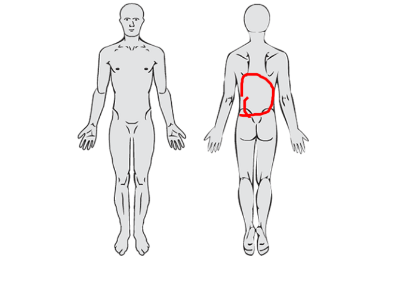
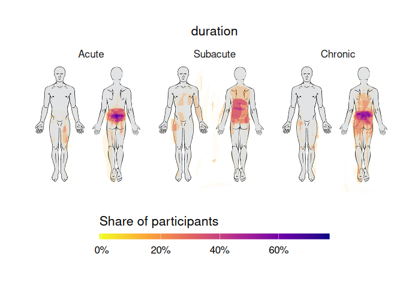

<!-- README.md is generated from README.Rmd. Please edit that file -->

# paindrawr

<!-- badges: start -->

<!-- badges: end -->

**paindrawr** helps you import, transform, quantify, and visualise *pain
drawings* — schematic illustrations on which patients mark where they
feel pain on an outline of the human body.

Pain drawings have traditionally been scored by dividing the body into a
fixed set of anatomical regions and recording, for each region, whether
it was marked or not. Modern digital tools (web and tablet apps) instead
capture each drawing as a series of pen-stroke *x/y coordinates*. This
coordinate-based data is far richer, but it is also harder to work with.
paindrawr provides a consistent workflow for turning that raw coordinate
data into figures and quantitative summaries.

## Installation

You can install the development version of paindrawr from
[GitHub](https://github.com/steenharsted/paindrawr) with:

``` r
pak::pak("steenharsted/paindrawr")
```

## Data structure

paindrawr works with a tibble in which each row is one respondent. The
pain drawings themselves live in a dedicated list-column, so that each
drawing — its metadata, strokes, and point coordinates — travels
alongside any covariates you have collected (for example sex, age,
symptom duration, or pain intensity). The list column name defaults to
`pdr_data`, but can take any name.

The package ships with `pdr_example_data` that has exactly this format,
and is used throughout the documentation.

A detailed description of the pain-drawing data structure will be
provided in a separate vignette.

## Example

paindrawr is built to work within the
[tidyverse](https://www.tidyverse.org/): drawings are stored in a
list-column of a tibble, and the `pdr_*()` functions are designed to be
used with the native pipe (`|>`) alongside familiar verbs like
`mutate()` and `filter()`. The examples below load the tidyverse for
this reason.

The example dataset contains 50 respondents, each with a pain drawing in
the `pdr_data` column plus a few covariates:

``` r
library(paindrawr)
library(tidyverse)

pdr_example_data
#> # A tibble: 50 × 6
#>    id                               pdr_data          sex      age duration  pain
#>    <chr>                            <list>            <fct>  <dbl> <fct>    <dbl>
#>  1 6d63804892233bbb18bc21bcf0d81d0d <named list [10]> Female  64.3 Subacute     3
#>  2 c8b12cd45d08e94241d4de9990d60f71 <named list [10]> Female  62.8 Subacute     9
#>  3 25062ac7dbeb08d8b532ac474a7849ca <named list [10]> Male    45.6 Chronic      2
#>  4 0dc657fa6ed70150f9596fe692f2f9a0 <named list [10]> Male    65.1 Chronic     10
#>  5 fb61c33ffa09270a5c7931813e9d2d71 <named list [10]> Male    21.2 Acute        4
#>  6 328d31503202db3e5c1b8e78f287810e <named list [10]> Female  46.7 Subacute    10
#>  7 e07d8d7e7034ba3ae7f907de022af58d <named list [10]> Male    22.6 Chronic      2
#>  8 9996f1a95c8e939c6ab6258bfc76f722 <named list [10]> Male    70.9 Chronic      3
#>  9 41aa308e694ad270b7cfaea054c7c1a2 <named list [10]> Female  58.3 Acute        0
#> 10 0bcfd36a71b799e857f13c29011d21ff <named list [10]> Female  98   Acute        4
#> # ℹ 40 more rows
```

Metadata stored inside each drawing can be pulled out with
`pdr_get_info()`. Because the drawings live in a list-column, you can
add drawing-level metadata as new columns with `mutate()` — for example
the canvas width of each drawing:

``` r
pdr_example_data|>
  mutate(width = pdr_get_info(pdr_data, id1 = ".width"))
#> # A tibble: 50 × 7
#>    id                               pdr_data          sex      age duration  pain width
#>    <chr>                            <list>            <fct>  <dbl> <fct>    <dbl> <int>
#>  1 6d63804892233bbb18bc21bcf0d81d0d <named list [10]> Female  64.3 Subacute     3   450
#>  2 c8b12cd45d08e94241d4de9990d60f71 <named list [10]> Female  62.8 Subacute     9   450
#>  3 25062ac7dbeb08d8b532ac474a7849ca <named list [10]> Male    45.6 Chronic      2   450
#>  4 0dc657fa6ed70150f9596fe692f2f9a0 <named list [10]> Male    65.1 Chronic     10   450
#>  5 fb61c33ffa09270a5c7931813e9d2d71 <named list [10]> Male    21.2 Acute        4   450
#>  6 328d31503202db3e5c1b8e78f287810e <named list [10]> Female  46.7 Subacute    10   450
#>  7 e07d8d7e7034ba3ae7f907de022af58d <named list [10]> Male    22.6 Chronic      2   450
#>  8 9996f1a95c8e939c6ab6258bfc76f722 <named list [10]> Male    70.9 Chronic      3   450
#>  9 41aa308e694ad270b7cfaea054c7c1a2 <named list [10]> Female  58.3 Acute        0   450
#> 10 0bcfd36a71b799e857f13c29011d21ff <named list [10]> Female  98   Acute        4   450
#> # ℹ 40 more rows
```

### Recreate a single drawing

`pdr_plot_xy()` redraws an individual pain drawing from its coordinates.
Pipe in a single row of the tibble:

``` r
pdr_example_data|>
  head(1) |>
  pdr_plot_xy()
```


### Adding bakground image

Plots of individual drawings and heatmaps are more interpretable when
they include the background image that used during datacollection.

``` r
background <- pdr_example_file("bg_full_body.png")

# To use your own pngs as background use png::readPNG
background <- png::readPNG("inst/extdata/bg_full_body.png")


pdr_example_data|>
  head(1) |>
  pdr_plot_xy(
    background_image = background
  )
```



### polygons or xy?

``` r
pdr_example_data|>
  head(1) |>
  pdr_plot_xy(
    background_image = background, 
    polygon = "both"
  )
```


### In this case polygon

Add rgba with polygons

``` r
pdr_example_data <- pdr_example_data|>
  mutate(
    pdr_data = pdr_add_rgba(pdr_data, polygon = "both")
    )

  
```

### Heatmaps across groups

`pdr_plot_rgba_heatmap()` aggregates many drawings into density
heatmaps, optionally stratified by one or two grouping variables. Here
we stratify by symptom duration:

``` r
pdr_example_data|>
  pdr_plot_rgba_heatmap(
    variables = "duration", 
    background_image = background)
```



## Typical workflow

paindrawr functions are organised around a common analysis pipeline:

- **Import** raw drawings — `pdr_import_json()`, `pdr_import_png()`
- **Check** that the data is well-formed — `pdr_match()`
- **add rgba** Consider xy (typical for spray tools) or polygons
  (typical for pen tools)
- **Quantify** the marked areas — `pdr_summarize_rgba()`
- **Visualise** the results — `pdr_plot_rgba()`,
  `pdr_plot_rgba_heatmap()`

## Rendering this README

This file is generated from `README.Rmd`. After editing, re-render it
with `devtools::build_readme()` and commit the resulting `README.md` and
any figure files under `man/figures/` so they display on GitHub.
