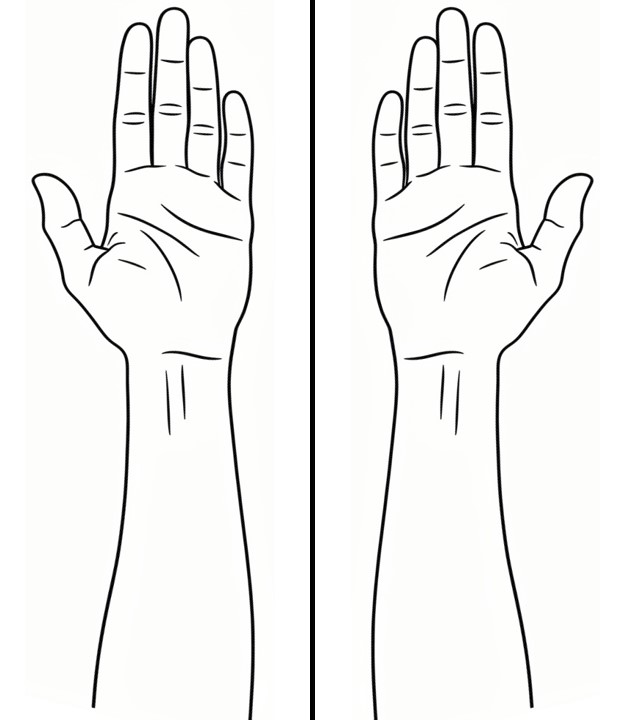

# How to create a stencil

``` r

library(paindrawr)
```

## Overview

This page is under construction. It shows the two patterns used for
vignette files: reading package data with
[`system.file()`](https://rdrr.io/r/base/system.file.html) and
displaying a static image.

## Using data shipped with the package

Files that code in the vignette needs to read live in `inst/extdata/`.
Locate them with
[`system.file()`](https://rdrr.io/r/base/system.file.html), which works
during `R CMD check`, after installation, and in pkgdown.

``` r

dxf_path <- system.file("extdata", "LibreCAD_test_1.dxf", package = "paindrawr")
file.exists(dxf_path)
#> [1] TRUE

bg_path <- system.file("extdata", "bg_lower_arm_palmar.png", package = "paindrawr")
file.exists(bg_path)
#> [1] TRUE
```

An image from `inst/extdata/` can also be read and plotted:

``` r

img <- png::readPNG(bg_path)
dim(img)
#> [1] 720 624   3
```

## Inserting a static image

Screenshots and other images that are only displayed live in
`vignettes/images/` and are included with
[`knitr::include_graphics()`](https://rdrr.io/pkg/knitr/man/include_graphics.html).

``` r


```


Lower arm, palmar view.
