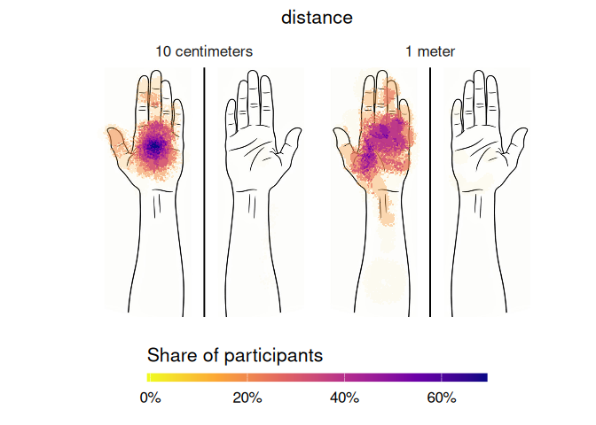

# paindrawr 

**paindrawr** is an R package for analysing and visualising pain
drawings — illustrations on which patients indicate where they
experience pain. Pain drawings typically use a full-body outline but can
also focus on specific anatomical regions.

The package provides tools to import pain drawing data, visualise the
marked areas, and quantify pain location, distribution, and extent. This
allows researchers to turn patient-reported pain drawings into
quantitative data for statistical analysis.

Pain drawings have traditionally been scored by dividing the body into a
fixed set of anatomical regions and recording, for each region, whether
it was marked or not. Modern digital tools (web and tablet apps) instead
capture each drawing as a series of pen-stroke *x/y coordinates*. This
coordinate-based data is far richer, but it is also harder to work with.
paindrawr provides a consistent workflow for turning that raw coordinate
data into figures and quantitative summaries.

## Installation

You can install the development version of paindrawr from
[GitHub](https://github.com/steenharsted/paindrawr) with:

``` r

pak::pak("steenharsted/paindrawr")
```

## Collect with paindraw. Analyse with paindrawr.


**paindraw** is a REDCap external module for collecting digital pain
drawings.

**paindrawr** is an R package for importing, quantifying, analysing, and
visualising pain drawings.

Together, they provide a workflow from digital data collection to
research-ready results.

## Typical workflow

paindrawr functions are organised around a common analysis pipeline:

1.  **Import** raw drawings:
    [`pdr_import_json()`](https://steenharsted.github.io/paindrawr/reference/pdr_import_json.md),
    [`pdr_import_png()`](https://steenharsted.github.io/paindrawr/reference/pdr_import_png.md)
2.  **Check** individual drawings against the background image with
    [`pdr_plot_xy()`](https://steenharsted.github.io/paindrawr/reference/pdr_plot_xy.md),
    to confirm face validity and to decide how to rasterise them
3.  **Rasterise** the strokes to an RGBA array with
    [`pdr_add_rgba()`](https://steenharsted.github.io/paindrawr/reference/pdr_add_rgba.md).
    Choose `polygon = "none"` to keep strokes as drawn, or `"pen"`,
    `"spray"` or `"both"` to render them as filled polygons.
4.  **Quantify** the marked areas:
    [`pdr_summarize_rgba()`](https://steenharsted.github.io/paindrawr/reference/pdr_summarize_rgba.md)
5.  **Visualise** the results:
    [`pdr_plot_xy()`](https://steenharsted.github.io/paindrawr/reference/pdr_plot_xy.md),
    [`pdr_plot_rgba()`](https://steenharsted.github.io/paindrawr/reference/pdr_plot_rgba.md),
    [`pdr_plot_rgba_heatmap()`](https://steenharsted.github.io/paindrawr/reference/pdr_plot_rgba_heatmap.md)

## Data structure

paindrawr works with a tibble in which each row is one respondent. The
pain drawings live in a dedicated list-column (named `pdr_data` by
default, but any name can be used), so that each drawing, with its
metadata, strokes and point coordinates, travels alongside covariates
such as sex, age, symptom duration or pain intensity.

The package ships with several example datasets; this README uses
`pdr_example_palmar`. In it, the drawing column is called `palmar`,
which is why later code uses `pdr_col = palmar`. See
[`?pdr_match`](https://steenharsted.github.io/paindrawr/reference/pdr_match.md)
for the terminology (pdr_drawing, pdr_list, pdr_tibble).

## Example

The `pdr_*()` functions are designed to be used with the native pipe
(`|>`) alongside tidyverse verbs such as
[`mutate()`](https://dplyr.tidyverse.org/reference/mutate.html) and
[`filter()`](https://dplyr.tidyverse.org/reference/filter.html).

``` r

library(paindrawr)
library(dplyr)

pdr_example_palmar
#> # A tibble: 30 × 4
#>       id palmar            tool   distance      
#>    <dbl> <list>            <fct>  <fct>         
#>  1     1 <named list [10]> Hammer 10 centimeters
#>  2     2 <named list [10]> Apple  1 meter       
#>  3     3 <named list [10]> Apple  1 meter       
#>  4     4 <named list [10]> Apple  1 meter       
#>  5     5 <named list [10]> Apple  10 centimeters
#>  6     6 <named list [10]> Hammer 1 meter       
#>  7     7 <named list [10]> Hammer 10 centimeters
#>  8     8 <named list [10]> Apple  10 centimeters
#>  9     9 <named list [10]> Apple  1 meter       
#> 10    10 <named list [10]> Hammer 1 meter       
#> # ℹ 20 more rows
```

`pdr_example_palmar` is a small, deliberately silly dataset with 30
respondents. Each person imagined that an object (`tool`: an apple or a
hammer) had fallen onto their left hand from a given height (`distance`:
10 cm or 1 m), and drew their imaginary pain on a palmar lower-arm
template.

### Plot a single drawing

[`pdr_plot_xy()`](https://steenharsted.github.io/paindrawr/reference/pdr_plot_xy.md)
redraws a drawing from its coordinates. Plots are easier to interpret
with the background image used during data collection. Use
[`pdr_example_file()`](https://steenharsted.github.io/paindrawr/reference/pdr_example_file.md)
to get an example image, or read your own PNG with
[`png::readPNG()`](https://rdrr.io/pkg/png/man/readPNG.html).

``` r

background <- pdr_example_file("bg_lower_arm_palmar.png")

pdr_example_palmar |>
  head(1) |>
  pdr_plot_xy(
    pdr_col = palmar,
    background_image = background)
```


Strokes can also be rendered as filled polygons, which usually suits
drawings made with a pen tool (see `pdr_example_data` and
`pdr_example_zeeland`). `pdr_example_palmar` was drawn with a spray tool
(many individual points), but you can still render it as polygons with
`polygon = "both"`.

``` r

pdr_example_palmar |>
  head(1) |>
  pdr_plot_xy(
    pdr_col = palmar,
    background_image = background, 
    polygon = "both")
```


### Quantify drawings

Quantification and heatmaps work on a rasterised representation of each
drawing, added to the list-column with
[`pdr_add_rgba()`](https://steenharsted.github.io/paindrawr/reference/pdr_add_rgba.md).
We store the result in `pd` and reuse it below:

``` r

pd <- pdr_example_palmar |>
  mutate(palmar = pdr_add_rgba(palmar))
```

[`pdr_summarize_rgba()`](https://steenharsted.github.io/paindrawr/reference/pdr_summarize_rgba.md)
then computes summary statistics, such as the number of drawn pixels
(`px`) and the proportion of the canvas covered (`area_prop`):

``` r

pd |>
  pdr_summarize_rgba(
    pdr_col = palmar,
    summary_stat = c("px", "area_prop")) 
#> # A tibble: 30 × 6
#>       id palmar            tool   distance       palmar_px palmar_area_prop
#>    <dbl> <list>            <fct>  <fct>              <dbl>            <dbl>
#>  1     1 <named list [11]> Hammer 10 centimeters      4854          0.0108 
#>  2     2 <named list [11]> Apple  1 meter            14464          0.0322 
#>  3     3 <named list [11]> Apple  1 meter             3759          0.00837
#>  4     4 <named list [11]> Apple  1 meter             2125          0.00473
#>  5     5 <named list [11]> Apple  10 centimeters      1069          0.00238
#>  6     6 <named list [11]> Hammer 1 meter            46663          0.104  
#>  7     7 <named list [11]> Hammer 10 centimeters      4897          0.0109 
#>  8     8 <named list [11]> Apple  10 centimeters     13610          0.0303 
#>  9     9 <named list [11]> Apple  1 meter            13161          0.0293 
#> 10    10 <named list [11]> Hammer 1 meter            11527          0.0257 
#> # ℹ 20 more rows
```

Supplying `stencils` (for example body regions) gives statistics per
region; see
[`?pdr_summarize_rgba`](https://steenharsted.github.io/paindrawr/reference/pdr_summarize_rgba.md).

### Heatmaps across groups

[`pdr_plot_rgba_heatmap()`](https://steenharsted.github.io/paindrawr/reference/pdr_plot_rgba_heatmap.md)
aggregates many drawings into density heatmaps, optionally stratified by
one or two grouping variables. Here we compare drawings by `distance`,
the height the object fell from.

``` r

pd |>
  pdr_plot_rgba_heatmap(
    pdr_col = palmar, 
    variables = "distance",
    background_image = background
  )
```



## Importing your own data

``` r

# Drawings exported as JSON from the REDCap PainDraw module
pdr_import_json(list.files("path/to/json", full.names = TRUE))
```

See
[`?pdr_import_json`](https://steenharsted.github.io/paindrawr/reference/pdr_import_json.md)
and
[`?pdr_import_png`](https://steenharsted.github.io/paindrawr/reference/pdr_import_png.md)
for details.
