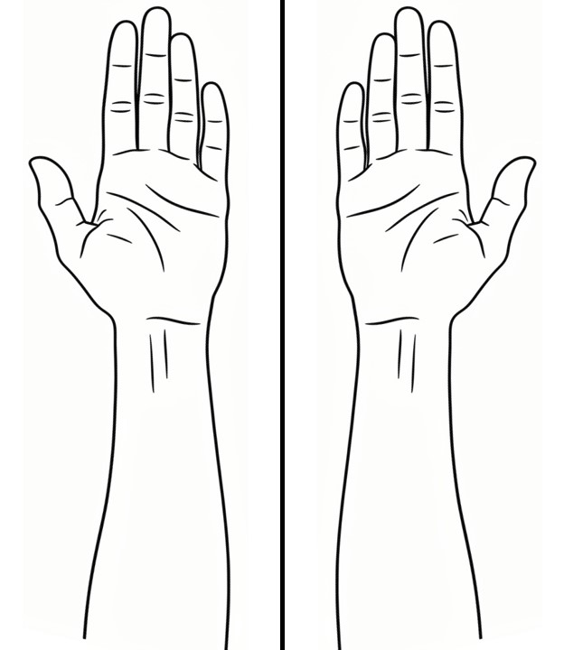

```{r}
#| label: setup
library(paindrawr)
```

# Overview

This page is under construction. It shows the two patterns used for
vignette files: reading package data with `system.file()` and displaying
a static image.

# Using data shipped with the package

Files that code in the vignette needs to read live in `inst/extdata/`.
Locate them with `system.file()`, which works during `R CMD check`, after
installation, and in pkgdown.

```{r}
#| label: locate-files
dxf_path <- system.file("extdata", "LibreCAD_test_1.dxf", package = "paindrawr")
file.exists(dxf_path)

bg_path <- system.file("extdata", "bg_lower_arm_palmar.png", package = "paindrawr")
file.exists(bg_path)
```

An image from `inst/extdata/` can also be read and plotted:

```{r}
#| label: read-png
img <- png::readPNG(bg_path)
dim(img)
```

# Inserting a static image

Screenshots and other images that are only displayed live in
`vignettes/images/` and are included with `knitr::include_graphics()`.

```{r}
#| label: static-image
#| fig-cap: "Lower arm, palmar view."

```
